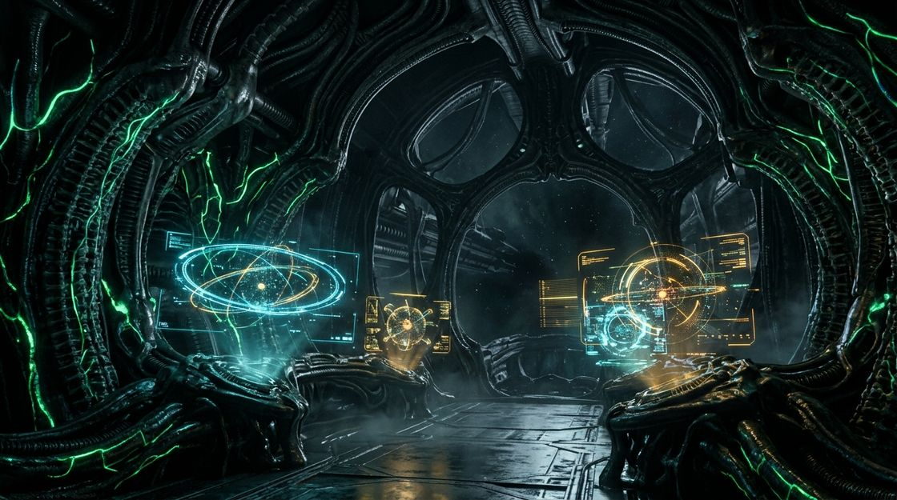

# XENO-STARK // CHRONICLE Mk.85 (`raiinman/xeno-stark-visualizer`)

> **Tony Stark's J.A.R.V.I.S. 3D Orbital Hologram meets *Alien* Nostromo MUTHUR-6000 Bio-Mechanical Git Telemetry.**
> 100% Clean-Room **MIT Licensed** (zero GPL-3.0 code required) • Installed with the **[`raiinman/dox`](AGENTS.md)** (`agent0ai/dox`) Self-Documenting `AGENTS.md` Hierarchy.



## Why Xeno-Stark Beats Basic 2D Repo Visualizers

| Capability | `Jany-M/repo-visualizer` | `raiinman/xeno-stark-visualizer` (Ours) |
| :--- | :--- | :--- |
| **License** | Restrictive **GPL-3.0** copyleft | Permissive **MIT License** (100% Clean-Room) |
| **Visual Engine** | Flat 2D circles on plain canvas | **3D WebGL Orbital Gimbal Hologram + Biomechanical Neural Tendrils + Custom ImageGen Assets** |
| **Spatial Topologies** | Single 2D force ring | **3 Live 3D Topologies**: Orbital Gimbal Rings, Xeno DNA Double-Helix, and Fibonacci Hive Sphere |
| **Dependency Analysis** | Direct 1-hop `Depends on` / `Imported in` only | **Xeno-Contagion Transitive Blast-Radius Solver** (1st, 2nd, and 3rd+ degree cascade simulation) |
| **Agent Documentation** | None | Full **[`raiinman/dox`](AGENTS.md)** self-documenting `AGENTS.md` hierarchy (`root`, `src/`, `scripts/`, `public/`) |
| **Audio Telemetry** | Silent | **Web Audio API Synthesizer** (Stark HUD servo chimes + Nostromo MUTHUR-6000 computer clicks) |

## Quick Start

1. **Open Immediately (Zero Build Step Required)**:
   Open `index.html` in any browser to explore 3 built-in multi-commit repositories (`raiinman/xeno-stark-visualizer`, `raiinman/dead-signal-valley`, and `raiinman/dox-agent-mesh`), switch between **1:ARC-XENO**, **2:J.A.R.V.I.S.**, and **3:MUTHUR-6000**, and fire live **Contagion Blast-Radius Cascades**.

2. **Analyze Any Local Git Repository**:
   ```bash
   node scripts/analyze.mjs /path/to/your/repo --max=400
   ```
   Walks `git log --reverse --numstat`, resolves cross-file imports across JS/TS, Python, Go, Rust, C/C++, Java/Kotlin, Ruby, PHP, and CSS/SCSS, maps each file to its nearest owning `AGENTS.md` DOX contract, and writes `public/data/history.json`.

3. **Publish Directly to `github.com/raiinman`**:
   ```bash
   bash scripts/publish-github.sh raiinman/xeno-stark-visualizer
   ```
